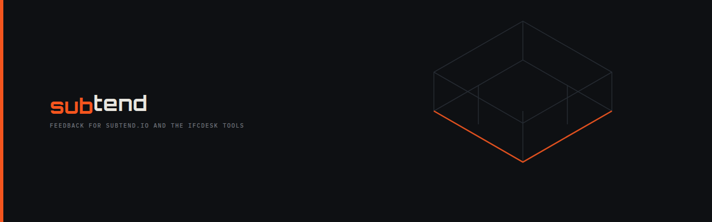

# subtend feedback

**Problems, questions, ideas and news for subtend.io and the ifcdesk tools.**

The one way to reach [subtend](https://subtend.io) and
[ifcdesk](https://subtend.io/office), its suite of IFC tools. There's no
contact form and no inbox: everything comes here, in the open, where one
person's question is often the next person's answer.

---

## Where to go

| You want to | Go to |
|---|---|
| Report something that doesn't work | [New issue → Something doesn't work](https://github.com/Subtend-io/feedback/issues/new/choose) |
| Suggest an idea, or ask a question | [New issue → An idea or a question](https://github.com/Subtend-io/feedback/issues/new/choose) |
| Hear when a tool is released, or the ifcdesk office beta opens | [Releases](https://github.com/Subtend-io/feedback/releases), or its [Atom feed](https://github.com/Subtend-io/feedback/releases.atom), which needs no account |
| Report a security problem | [Report a vulnerability privately](https://github.com/Subtend-io/feedback/security/advisories/new), never a public issue. See [SECURITY.md](SECURITY.md) |

Reading anything here needs no account. Opening an issue, or a private
report, needs a free GitHub account.

## Before you post

**Everything posted here is public.** Please don't attach models, drawings or
reports that aren't yours to share. A screenshot of the problem, or the
tool's own error message, is usually enough.

The ifcdesk tools read your models on your own machine and never upload them.
Please keep it that way here: describe the model, rather than attaching it.

## The tools

**Released, in beta:** free, in your browser, with nothing to install.

-  **[ifcdesk health](https://subtend.io/ifcdesk/health)**: check model quality and validate against your IDS requirements. At [health.ifcdesk.co.uk](https://health.ifcdesk.co.uk).
-  **[ifcdesk specify](https://subtend.io/ifcdesk/specify)**: write IDS from the spreadsheets and models you already have. At [specify.ifcdesk.co.uk](https://specify.ifcdesk.co.uk).

**In development:**

-  **[ifcdesk space](https://subtend.io/ifcdesk/space)**: a datasheet for any room in the model.
-  **[ifcdesk coordinate](https://subtend.io/ifcdesk/coordinate)**: view discipline models together in 3D, and track the issues between them.
-  **[ifcdesk bcf](https://subtend.io/ifcdesk/coordinate#bcf)**: open and review BCF issue files from any tool, in your browser. Part of coordinate, and a tool of its own.
-  **[ifcdesk office](https://subtend.io/office)**: every ifcdesk tool in a single application, on the desktop and the web. Free through its beta.

Problems can be reported for the released tools and the site. Ideas are
welcome for all of them: what you'd want from a tool still in development
helps decide what it becomes.

## A useful report

The form asks for each of these. The more of them a report has, the sooner
the problem can be found:

1. **The tool, and its version.** The version is in the tool's footer or its
   About.
2. **What you saw, word for word.** The tool's own message, or a screenshot
   of it.
3. **What you expected instead.**
4. **How to make it happen again,** step by step from opening the tool.
5. **Your browser and system,** such as Firefox 140 on Windows 11.

If it only happens with one model, say what's particular about it: the
schema (IFC2X3, IFC4 or IFC4.3), the software that exported it, roughly how
big it is.

And "this was confusing" is as useful as a bug report.

## News

Each [release](https://github.com/Subtend-io/feedback/releases) here is an
announcement: a tool released, a new version, the ifcdesk office beta
opening. There's no mailing list, so there's nothing to sign up to.

- **With a GitHub account:** Watch → Custom → Releases, at the top of this
  page.
- **Without one:** add `https://github.com/Subtend-io/feedback/releases.atom`
  to any feed reader.

## Policies

The policies that cover the site and every tool:

| Ref | Policy | In short |
|---|---|---|
| P&#8209;01 | [Privacy](https://subtend.io/policies/privacy) | Your models never leave your device, and we collect no personal information. |
| P&#8209;02 | [Terms](https://subtend.io/policies/terms) | Free to use and provided as-is, and what a passing check does and does not mean. |
| P&#8209;03 | [Security](https://subtend.io/policies/security) | How to report a security problem privately, and what happens next. |
| P&#8209;04 | [Notices](https://subtend.io/policies/notices) | Licences and attribution for the software and typefaces subtend.io ships. |
| P&#8209;05 | [Accessibility](https://subtend.io/policies/accessibility) | What we do so everyone can use the site and tools, what isn't right yet, and how to tell us. |

## About subtend

**subtend** *(verb)*: to stretch beneath; to underlie so as to include.

A hypotenuse subtends a right angle: it's the line that runs under the shape
and holds it together. subtend makes tools that sit beneath the work rather
than in front of it: quick to open, honest about what they do, and out of
the way.

subtend is a personal, non-commercial project in the UK. There's no team on
call, but every issue is read.
